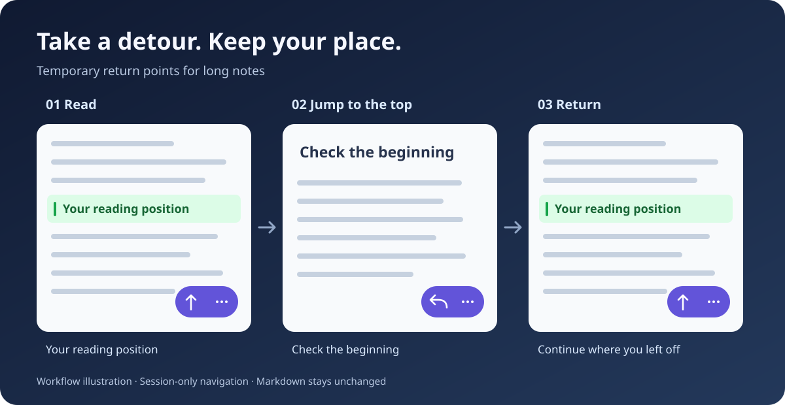

# Read & Return

**Explore a long note. Come back to where you were.**

**English** · [简体中文](README.zh-CN.md)



Read & Return adds temporary return points and position history to long Markdown notes in Obsidian. Check the beginning, visit another section, or jump to the end—then return to your reading position without searching for it again.

**Mobile-first controls · Keyboard commands · No changes to your Markdown**

> Publication status: this project is not yet listed in Community plugins. Version **0.1.5** is the planned first public snapshot; the declared minimum Obsidian version is **1.8.7**. Real-device acceptance testing is still pending.

## A small control for a long note

1. Read anywhere in a long note.
2. Tap **↑** to remember your visible position and jump to the top.
3. Tap **↩** to return. The button becomes **↑** again, ready for your next detour.

Want to visit a different section? Open **⋯ → Set return point**, navigate using scrolling or Obsidian's outline, then return when you're done.

*The illustration explains the workflow; it is not an Obsidian screenshot.*

## What you can do

| Action | What happens |
| --- | --- |
| Top / return | One button switches between jumping to the top and returning to your saved position. |
| Jump to bottom | Visit the end of the note while remembering where you came from. |
| Set return point | Save a temporary position before exploring another section. |
| Go back / Go forward | Move through this note's plugin navigation history. |
| Clear note navigation | Remove the current note's temporary return point and history. |

Each note has its own return point and history. Renaming or moving a note or folder updates its session records; deleting a note clears its records.

## Install the current version

Until this project is published, install it manually in a test vault:

1. Copy the entire [`release/0.1.5/read-and-return/`](release/0.1.5/read-and-return/) folder into `<your vault>/.obsidian/plugins/`.
2. Check that the plugin folder directly contains `manifest.json`, `main.js`, and `styles.css`.
3. Reload Obsidian, open **Settings → Community plugins**, and enable the plugin.
4. For mobile, place the same plugin files in the vault used by your phone and enable it there too.

Once a GitHub release exists, its three individual runtime assets can be installed in the same way. GitHub's automatic source-code ZIP is not the installable plugin package.

When upgrading from the local Note Navigator prototype, disable the old plugin first. Appearance preferences are not migrated automatically to the new ID.

## Make it fit your workflow

**On mobile:** the floating control is enabled by default. Use **⋯** for the full menu. Choose the left or right side and adjust bottom spacing in settings. Mobile reserves at least 96 px plus the system safe area; increase spacing up to 160 px for taller toolbars.

**On desktop:** use the ribbon navigation icon or open the command palette and search for `Read & Return`. Assign shortcuts under **Settings → Hotkeys** if you like. The desktop floating control is optional and off by default. No shortcuts are assigned automatically.

The interface follows Obsidian's language: Simplified Chinese uses Chinese labels; all other languages, including Traditional Chinese, use English. Reload the plugin after changing Obsidian's language to refresh command names.

## Your notes stay yours

- **No Markdown edits.** No generated block IDs, HTML comments, headings, or frontmatter for tracking positions.
- **Session-only navigation.** Return points and history disappear when you disable the plugin or restart Obsidian. Only appearance preferences are saved in the plugin's `data.json`.
- **Local operation.** No network requests, analytics, accounts, or paid services are required by this plugin.
- **Bounded history.** Up to 50 entries per direction per note and 100 recently used notes. Least recently used note records are evicted when that limit is reached.

## Behavior and limitations

Ordinary scrolling, native links, and switching files do not automatically add history. History records plugin navigation and manually set return points; it is separate from Obsidian's file navigation history. Each note has one temporary return point, consumed after a successful return.

Restoration combines text and nearby context, heading context, line position, and scroll ratio. Major edits may require an approximate return, with a notice. Font changes, images loading, folded sections, and complex embeds can affect visual accuracy. Persistent bookmarks and restoring your last reading position after a restart are not included.

| Surface | Current verification |
| --- | --- |
| Desktop Reading View | Adapter/host simulations; real-app testing pending |
| Desktop Live Preview / Source Mode | Adapter/host simulations; real-app testing pending |
| Mobile/iOS Reading View | Real-device testing pending |
| Mobile/iOS editor | Real-device testing pending |

Automated tests include an **84,003-line** Markdown fixture. They do not substitute for Obsidian rendering and device testing. The declared minimum version also needs real-app verification.

## Development and feedback

Use Node.js 22 and npm:

```sh
npm ci
npm run release
```

This runs TypeScript checks, a production build, automated tests, and version/package consistency checks. The installable output is `release/0.1.5/read-and-return/`.

Report issues with your Obsidian version, device/OS, view mode, theme, reproduction steps, and a small non-sensitive example note. Use this repository's Issues tab once published.

- [Development and acceptance tests](docs/DEVELOPMENT.md) · [Architecture](docs/ARCHITECTURE.md) · [Data model](docs/DATA-MODEL.md)
- [Interaction details](docs/UX.md) · [Changelog](CHANGELOG.md)
- [First-publication guide / 首次上架指南](docs/PUBLISHING.zh-CN.md)

## License

[MIT](LICENSE). An independent community project, not an official Obsidian product.

