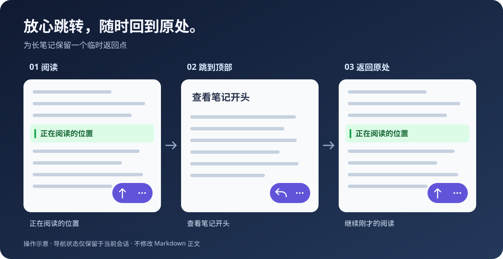

# Read & Return

**长笔记，放心跳；读到哪，回到哪。**

[English](README.md) · **简体中文**



Read & Return 为 Obsidian 长篇 Markdown 笔记提供临时返回点和位置历史。回看开头、查阅其他章节、跳到笔记末尾之后，都可以返回刚才的阅读位置，不必重新寻找。

**手机优先 · 支持键盘命令 · 不修改 Markdown 正文**

> 发布状态：本项目尚未上架社区插件市场。计划以当前 **0.1.5** 作为首个公开快照；声明最低 Obsidian 版本为 **1.8.7**。真实设备验收仍待完成。

## 三步，回到刚才读到的地方

1. 在长笔记任意位置阅读。
2. 点击 **↑**，自动记住可见位置并跳到顶部。
3. 点击 **↩**，回到原处；按钮恢复为 **↑**，可以开始下一次跳转。

想查看其他章节？在 **⋯ → 设置返回点** 中保存位置，再自由滚动或使用 Obsidian 大纲跳转，读完后返回。

*上图是操作流程示意，不是真实 Obsidian 截图。*

## 功能一览

| 操作 | 效果 |
| --- | --- |
| 顶部 / 返回 | 一个按钮切换“跳到顶部”和“返回刚才的位置”。 |
| 跳转到底部 | 到达笔记末尾，同时记住出发位置。 |
| 设置返回点 | 查看其他章节之前，手动保存一个临时位置。 |
| 位置后退 / 前进 | 在本篇笔记的插件导航历史中移动。 |
| 清除当前笔记导航记录 | 清除本篇的临时返回点和历史。 |

每篇笔记独立管理返回点和历史；重命名或移动笔记、文件夹会迁移会话记录，删除笔记会清理对应记录。

## 安装当前版本

上架之前，请在测试仓库手动安装：

1. 将 [`release/0.1.5/read-and-return/`](release/0.1.5/read-and-return/) 整个文件夹复制到 `<你的仓库>/.obsidian/plugins/`。
2. 确认插件文件夹内直接包含 `manifest.json`、`main.js`、`styles.css`，不要多套一层版本目录。
3. 重新加载 Obsidian，在 **设置 → 第三方插件** 中启用插件。
4. 手机端需要将相同文件放入手机使用的仓库，并在手机端启用。

GitHub Release 发布后，也可以下载其中三个独立运行文件，按同样方式安装。GitHub 自动生成的源码 ZIP 不等于可安装插件包。

从本地 Note Navigator 原型升级时，请先禁用旧插件。新 ID 不会自动迁移旧插件的外观设置。

## 按你的习惯使用

**手机端：**默认显示悬浮控件，通过 **⋯** 打开完整菜单。设置中可以切换左右侧和调整底部距离。移动端至少预留 96 px，再叠加系统安全区；较高工具栏可将底距增加到 160 px。

**桌面端：**通过左侧导航图标或命令面板使用，搜索 `Read & Return` 即可找到命令。可以在 **设置 → 快捷键** 自行绑定。桌面悬浮控件默认关闭，可以手动开启；插件不预占快捷键。

界面跟随 Obsidian 语言：简体中文显示中文，繁体中文和其他语言统一使用英文。更改 Obsidian 语言后，重新加载插件以更新命令名称。

## 导航状态与笔记内容分开

- **不修改正文：**不插入 block ID、HTML 注释、标题或 frontmatter 来记录位置。
- **会话内有效：**禁用插件或重启 Obsidian 后，返回点和历史会清空；只有外观偏好保存在插件自己的 `data.json`。
- **本地运行：**插件不需要网络请求、统计服务、账号或付费服务。
- **限制内存占用：**每篇笔记的前进、后退栈各最多 50 项，最多保留最近使用的 100 篇笔记；超过上限会淘汰最久未使用笔记的记录。

## 行为边界与兼容性

普通滚动、Obsidian 原生链接跳转和跨文件访问不会自动生成历史。插件历史记录插件导航及手动设置的返回点，与 Obsidian 文件访问历史独立。每篇笔记只有一个临时返回点，成功返回后消耗该点。

恢复结合原始文本、邻近上下文、标题章节、行位置和滚动比例。正文大幅改写后可能只能返回附近位置，并会提示。字体变化、图片加载、折叠章节和复杂嵌入可能影响视觉定位。当前不包含永久书签，也不支持重启后恢复上次阅读位置。

| 使用环境 | 当前验证状态 |
| --- | --- |
| 桌面阅读视图 | 已有适配器/宿主模拟测试；真实应用待验收 |
| 桌面实时预览 / 源码模式 | 已有适配器/宿主模拟测试；真实应用待验收 |
| 手机/iOS 阅读视图 | 真实设备待验收 |
| 手机/iOS 编辑器 | 真实设备待验收 |

自动化测试包含 **84,003 行**的 Markdown 长笔记样本，但不能替代 Obsidian 渲染和真机测试。声明的最低支持版本也需要实测。

## 开发与反馈

使用 Node.js 22 和 npm：

```sh
npm ci
npm run release
```

此命令执行 TypeScript 检查、生产构建、自动化测试、版本与打包一致性检查。安装包输出到 `release/0.1.5/read-and-return/`。

发布后，可在本仓库 Issues 中反馈问题。请提供 Obsidian 版本、设备/系统、视图模式、主题、复现步骤，以及不含隐私的最小示例笔记。

- [开发与验收](docs/DEVELOPMENT.md) · [架构](docs/ARCHITECTURE.md) · [数据模型](docs/DATA-MODEL.md)
- [交互细节](docs/UX.md) · [更新记录](CHANGELOG.md)
- [首次发布与社区上架指南](docs/PUBLISHING.zh-CN.md)

## 许可

采用 [MIT 协议](LICENSE)。本项目是独立社区项目，并非 Obsidian 官方产品。

